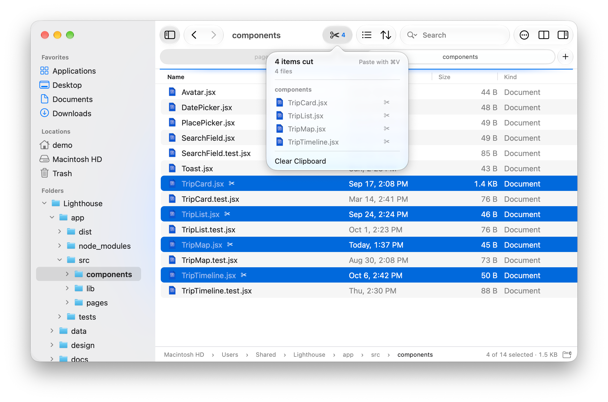
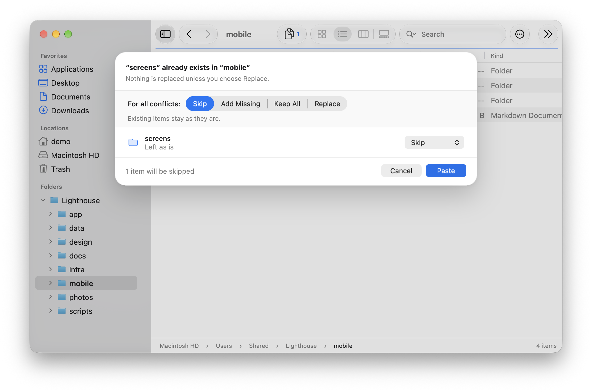
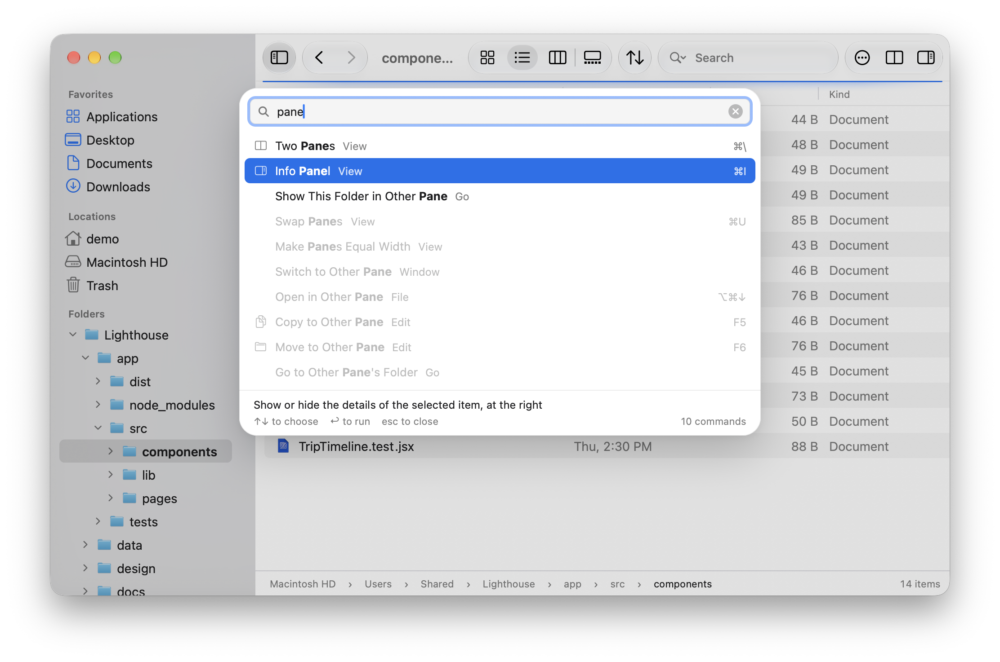
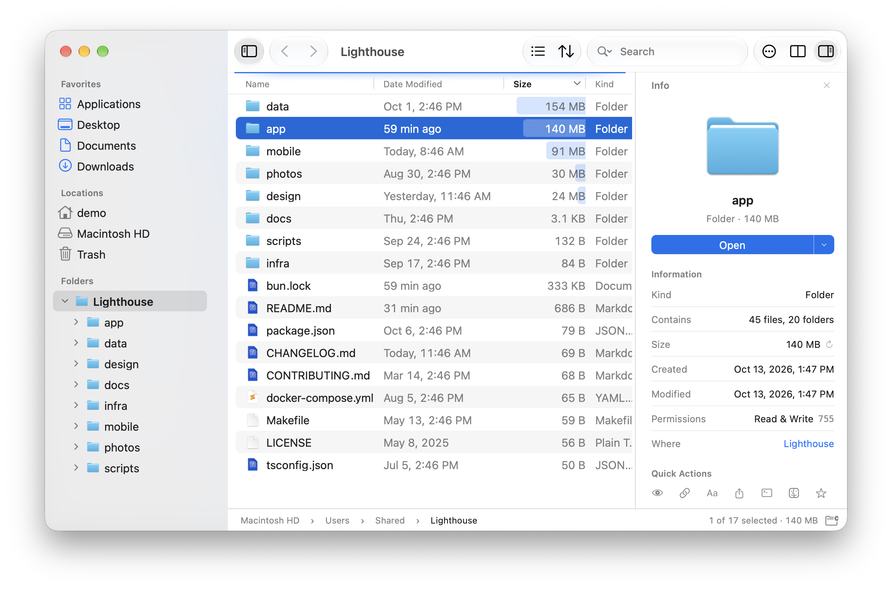
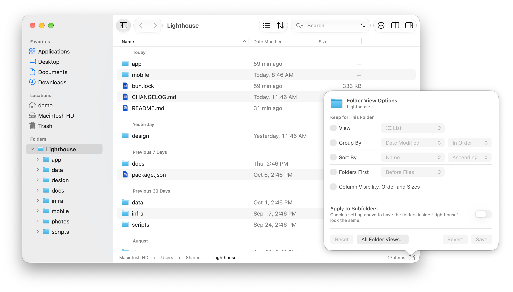
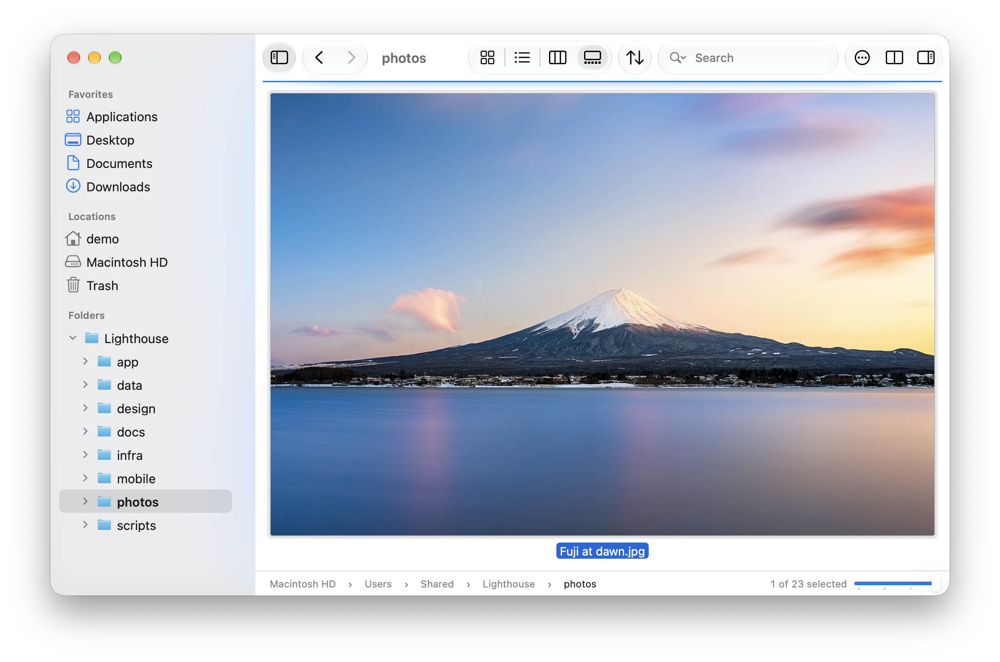

# File Trail

**The file browser for people who live in their files.** Instant search, a real folder tree, two panes side by side and true cut and paste, in a fast, native Mac app that keeps the shortcuts you already know.

  

  <a href="https://github.com/mdemirhan/filetrailnative/releases/latest"><strong>Download for Mac</strong></a>
  &nbsp;·&nbsp; macOS 26 Tahoe or later &nbsp;·&nbsp; Apple Silicon
  &nbsp;·&nbsp; <a href="docs/features.md">All features</a>

## Highlights

| | |
|---|---|
| **Search as you type** | Results from the folder you are in appear instantly, by name or full path, in plain text, glob or regex. No index to build, nothing left out. |
| **A real folder tree** | See where you are and what is around it. Expand any folder in place without leaving the one you are in. |
| **Two panes, one window** | Split any tab into two folders and copy or move between them with a single key. |
| **True cut and paste** | ⌘X and ⌘V move files. Gather items from many folders, then paste them all at once. |
| **Read and edit in place** | Code and text in color for about 60 languages, Markdown rendered, pictures shown, all beside the folder they live in. |
| **Built for the keyboard** | A command palette for every command, Go To for every folder, and shortcuts you choose. |
| **Safe by design** | Every replaced file goes to the Trash, moves across disks are verified, and Undo takes it all back. |
| **Private** | No account, no analytics, no network connections. Open source under the MIT License. |

If you know Finder, you already know File Trail: the familiar shortcuts, Quick Look, tabs, drag and drop and the sidebar's Locations all work the way you expect.

## Search that keeps up with you

Type in the search field and results appear as you type: everything under the folder you are in, each shown with the folder it lives in. Search reads the disk itself, so nothing depends on what an index happens to contain, and hidden files are one option away.

- **Plain text, glob or regex.** Case and accents don't get in the way (`resume` finds Résumé), and `*.test.ts` or a regular expression is a click away. Match against names or full paths.
- **Widen or narrow in one step.** Move the search from this folder to Home or the whole disk with one click, and filter what was found without searching again.
- **Aware of Git.** Inside a repository, search can skip `.git` and everything `.gitignore` excludes, so build output stays out of your results.
- **Group and sort results** by folder, kind, date, size or tag, in any view.
- **Nothing to set up.** Search is powered by a bundled copy of [`fd`](https://github.com/sharkdp/fd). Each tab keeps its own search, and it keeps running while you work in another.

## Two folders side by side

  

Press ⌘\\ and any tab becomes two panes, each with its own folder, history, view, filter and search. No second window to arrange.

- **Copy or move with one key.** F5 copies the selection to the other pane, F6 moves it, or drag it across. The result appears in both panes, selected.
- **Never leave the keyboard.** Tab cycles through the tree and both panes, ⌥⌘↓ opens a folder in the other pane, and ⌘U swaps them.
- **Save your layout.** Keep a tab's setup, say a list on the left and previews on the right, as a *tab view* and apply it to any tab with ⌥⌘1 to ⌥⌘5. A *window view* opens a whole window of tabs with ⌃⌘1 to ⌃⌘5.

## Cut and paste, gathered from anywhere

  

⌘X cuts and ⌘V moves, within a window or between windows. Cut and copied items stay marked until they are pasted, and a toolbar button lists them so you can review, remove or clear them.

**Collect files from many folders, then paste once.** ⌃⌘C and ⌃⌘X add to what is already on the clipboard instead of replacing it. Walk from folder to folder adding what you need, and a single ⌘V copies the copied items and moves the cut ones together. One Undo reverses the whole paste. Name clashes are raised as you add items, not halfway through the paste.

  

**Built never to lose your files.**

- **You decide what happens on a name clash:** Skip, Keep Both, Replace, or for folders, Add Missing, which copies only what the destination lacks.
- **Replace Older** brings a backup up to date: folders merge, and only newer files replace older ones.
- **Nothing replaced is destroyed.** It goes to the Trash. A move to another disk verifies each copy, and that the disk has saved it, before removing the original.
- **Interrupted operations resume.** If File Trail stops in the middle of a Replace, it finishes the next time it opens and tells you where everything is.
- **Undo (⌘Z)** reverses renames, moves, copies and Move to Trash, one step at a time.

File Trail's clipboard for files is its own, so cut and copied files are pasted within File Trail. To move files to other apps, drag them.

## Read and edit files where they are

  

Press Space or ⇧⌘E to open the selected file right in the window, highlighted for about 60 languages and formats. Switch to Edit to make a change and ⌘S to save. Or show files in the other pane and they follow your selection as you move through the list.

- **More than text.** Markdown is rendered, pictures are shown as pictures, and everything else appears as Quick Look shows it.
- **Part of browsing.** Back returns to the folder with the file selected, ⌥→ and ⌥← step through files, and unsaved edits are never lost without asking.
- **Read your way.** Light and dark themes, text size, line numbers, wrapping and Find.

## Small jobs, no extra apps

  

- **Paste as File (⇧⌘V)** saves a copied screenshot or text as a new file in the current folder.
- **Copy Contents (⇧⌘C)** puts a file's image or text on the clipboard without opening it.
- **Convert Images** to JPEG, HEIC, PNG, TIFF or AVIF, resized or not, with or without metadata and location.
- **Extract** zip, tar, 7z, RAR and xar archives in place or into a folder you choose.
- **Rename many files at once**, and **Compress** with a single command.

## Any folder, any command, in a few keystrokes

  

- **Go To (⌘K)** finds any folder you have visited from a few letters, ranking the ones you use most first, the way a browser's address bar does. Type `/` or `~` to enter a path, with Tab completion.
- **Type to filter.** Start typing in any folder to narrow it, no field to click. Fuzzy matching means `trtime` finds TripTimeline.jsx. Pin a filter and it follows you from folder to folder.

  

- **Command palette (⇧⌘P).** Every command, with its menu, shortcut and a short description. Recently used commands come first.
- **Your shortcuts.** Assign up to two shortcuts to any command in Settings, with a warning before one is taken from another command. Built-in Help lists every shortcut, including the ones you changed.

  

## See what's taking up space

  

Ask for a folder's size and File Trail measures it, and every folder inside it, in a single pass. Sort by size and each row gets a bar, so the heavy folders stand out at a glance. Sizes are computed only when you ask, so browsing large folders stays instant.

## Every folder the way you want it

  

- **Four views:** List, Icons, Compact List and Previews, which fills the pane with large previews of pictures and documents.
- **Grouping in every view** by name, date, size, kind or tag.
- **Views that stay with their folders.** Give a folder its own view, sort order, columns and grouping, for itself or everything inside it (⌘J). Changes are kept only when you save them, and nothing is ever written into your folders.

  

Previews (⌘4) fills the pane with 9, 4, 2 or 1 large previews, each in its own proportions. It is still a folder: select, rename, drag, cut and paste as in any other view.

## Fast, private and open source

- **Built for big folders.** Scrolling stays smooth with thousands of files, and every release is measured against the one before it. A slow or unresponsive disk or server never freezes the window.
- **Nothing leaves your Mac.** No account, no analytics, and no network connections of its own.
- **Native and small.** Written in Swift with AppKit, about 13 MB, in the system's look in Light and Dark.
- **Open source** under the [MIT License](LICENSE).

## Download

File Trail is signed and notarized by Apple.

1. Download `FileTrail-arm64.dmg` from the [latest release](https://github.com/mdemirhan/filetrailnative/releases/latest).
2. Drag **File Trail** into your Applications folder.
3. Open it.

**Requirements:** a Mac with Apple Silicon and macOS 26 Tahoe or later. New versions are announced on the [releases page](https://github.com/mdemirhan/filetrailnative/releases).

## Learn more

- [Everything File Trail does](docs/features.md), by area
- [Building and contributing](docs/development.md)
- [Privacy](docs/privacy.md)

## License

File Trail is open source under the [MIT License](LICENSE). The bundled `fd` keeps its own license (MIT or Apache 2.0), shown in the app's Acknowledgements.
