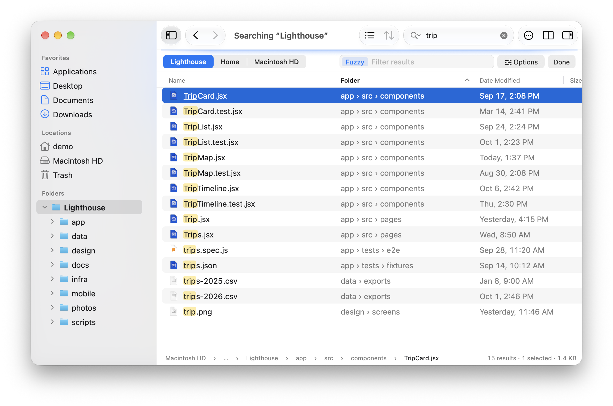
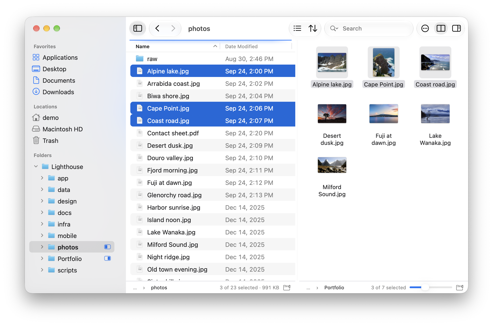
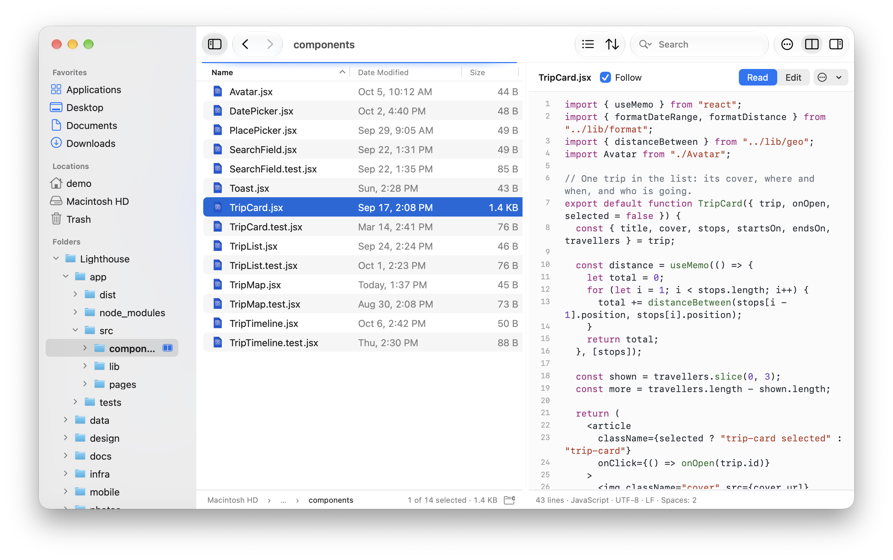
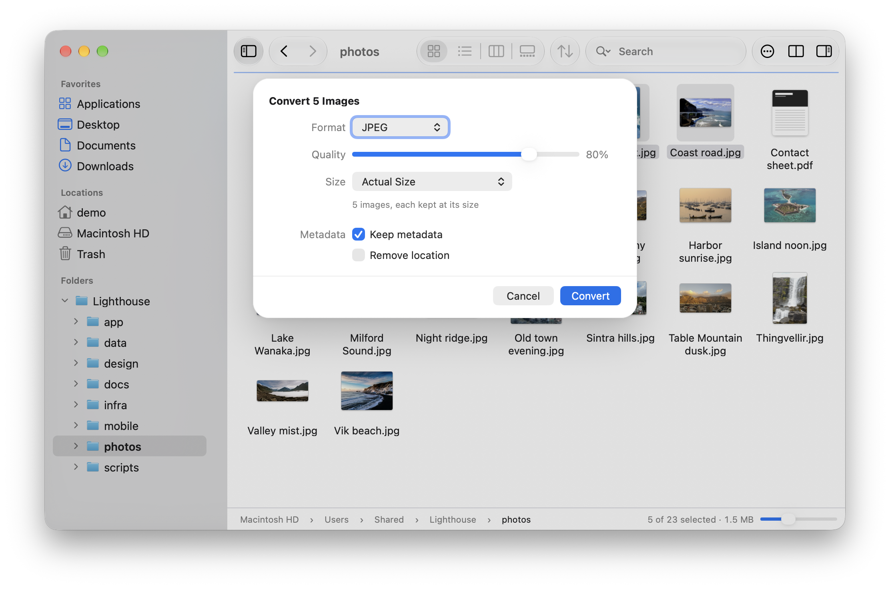
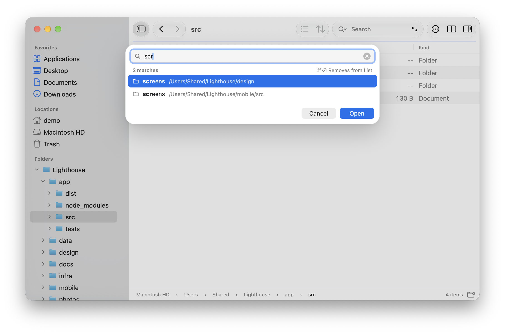
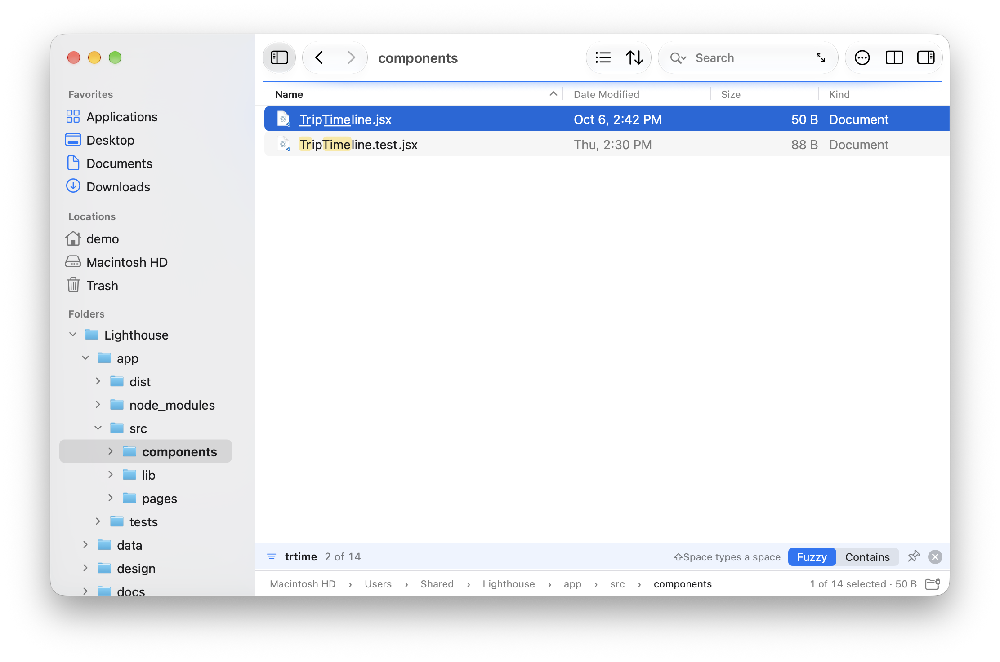

# File Trail

A Mac file browser with fast search, a real folder tree, two panes and true cut and paste, gathered from as many folders as you like. Most of the rest works the way it does in Finder.

<p align="center">
  
</p>

## Why switch from Finder

- **Search that works, and is fast.** Results appear as you type, from the folder you are in, by name or full path, in plain text, glob or regex. There is no index to wait for, and nothing left out for not being indexed.
- **A folder tree beside your files.** See where you are and what is around it, and open any folder's arrow to look inside without leaving.
- **Two folders side by side.** ⌘\\ splits a tab into two panes, and F5 and F6 copy or move what is selected from one to the other. No second window to line up, and a tab's panes and views can be saved as a tab view and given to any tab with a key.
- **Read and edit files where they are.** ⌘E shows a file's code or text in color, ready to edit, and the other pane can show each file as you move through the list.
- **Cut and paste files, from many folders at once.** ⌘X and ⌘V move files. The clipboard is a shelf you can keep adding to: ⌃⌘C and ⌃⌘X put more on it from folder after folder, and one ⌘V copies the copied ones and moves the cut ones together. What is on it stays marked until you paste, and a paste never destroys anything: what it replaces goes to the Trash.
- **Folder sizes when you ask.** A folder and every folder inside it are measured in one pass, and sorted by size each row gets a bar, so the heavy ones stand out.
- **Small jobs without another app.** Save a copied screenshot as a file, extract zip, 7z and RAR archives, and convert images, all where the files are.
- **Any folder, any command, in a few keystrokes.** ⌘K finds a folder you have used from a few letters, typing in a folder narrows it to the names that match, and ⇧⌘P finds any command by name. Every command can have a shortcut that you choose.
- **Fast, free, open source and private.** Smooth with thousands of files. MIT licensed, with no accounts, no analytics and nothing sent anywhere.

Switching is easy. File Trail keeps most of Finder's shortcuts, Quick Look on Space and ⌘Y, drag and drop with other apps, tabs, and the sidebar's Locations. This page is about what is different; [everything File Trail does](docs/features.md) is on a page of its own.

## Search that keeps up with your typing

Finder hands search to Spotlight: by default it searches the whole Mac, it leaves out hidden and system files and anything excluded in Spotlight's settings, and matching a pattern means writing a raw Spotlight query. In File Trail, type in the search field and results appear as you type: everything under the folder you are in, each with the folder it lives in.

- **Plain text by default.** Case doesn't matter, and a plain letter finds its accented forms: `resume` finds Résumé. Switch to glob (`*.test.ts`) or regex when you need a pattern, and match against the name or the full path.
- **Widen or narrow without starting over.** One click moves the search from this folder to Home or the whole disk, and the filter field trims what was found without searching again.
- **It knows about Git.** Inside a repository, search can leave out `.git` and whatever `.gitignore` excludes, so build output stays out of the results.
- **Nothing to set up.** Search runs on a bundled copy of [`fd`](https://github.com/sharkdp/fd). There is no index to build and nothing to install.

Each tab keeps its own search, and a search keeps running while you look at another tab.

## A folder tree, not just a sidebar

Finder's sidebar holds shortcuts, not a tree. File Trail keeps a folder tree beside the files, as every screenshot on this page shows: the folder you are in, the folders around it, and the way back up.

- Open a folder's arrow to look inside without leaving where you are.
- Make one folder the top of the tree while you work inside a project, and go back to Home with ⇧⌘H.
- Your favorites and Locations sit above the tree, and the tree hides when you want the room.

## Two folders side by side

<p align="center">
  
</p>

In Finder, moving files between two folders means two windows, or a drag held over another tab. In File Trail, press ⌘\\ and the tab shows a second pane beside the first, each with its own folder, history, view, filter and search.

- **Copy and move across with one key.** F5 copies what is selected into the other pane's folder and F6 moves it, and a drag from one pane to the other does the same. What arrives shows in both panes at once, selected.
- **Stay on the keyboard.** Tab moves between the tree and the two panes, ⌥⌘↓ opens the selected folder in the other pane, and ⌘U swaps the panes.
- **One tree for both.** The folder tree follows the pane you are in and marks the folder each pane shows.

A way of working can be saved and given back in one step. A tab view keeps what you choose of a tab, two panes in List and Previews, say, with or without their folders, and applies it to the tab you are in (⌥⌘1 to ⌥⌘5). A window view opens a window of such tabs (⌃⌘1 to ⌃⌘5). Both are in the Layout menu, beside each folder's own view.

## Read and edit a file beside its folder

<p align="center">
  
</p>

Quick Look shows a file but doesn't let you change it, and opening an editor takes you away from the folder. In File Trail, ⌘E shows the selected file in place of the folder, in color for about 60 languages and formats; switch to Edit to change it, and ⌘S saves. Show it in the other pane instead (⌥⌘↓) and it follows the list: move from file to file and each one appears beside it.

- **More than text.** Markdown shows as it reads, pictures as pictures, and anything else as Quick Look shows it.
- **Part of browsing.** Back returns to the folder with the file selected, ⌥⌘] and ⌥⌘[ step to the next and previous file, and the file asks before unsaved edits are lost.
- **Your way to read.** Light and dark themes of its own, the text size, line numbers, wrapped lines and Find are in the viewer's ⋯ menu.

## Cut, copy and paste, gathered from many folders

<p align="center">
  
</p>

In Finder, moving files with the keyboard means ⌘C and then ⌥⌘V, and that works here too. In File Trail, ⌘X cuts and ⌘V moves, in the same window or another of File Trail's. Cut and copied items stay marked until they are pasted, and a button in the toolbar counts them and lists them, so you can jump to one, take one off or clear the lot.

**Gather files from several folders, then paste them in one go.** The clipboard is a shelf you keep adding to: ⌃⌘C and ⌃⌘X add the selected items to what is on it, to be copied or moved, instead of starting over. Walk from folder to folder adding what you need; ⌘V then copies the copied ones and moves the cut ones together, ⌥⌘V moves them all, and one Undo takes it all back. The clipboard's list (⌃⌘V) shows what will move apart from what will be copied, and an item can be switched with a click. Two files of one name are asked about when the second is added, not in the middle of the paste, and a gathered list that a plain ⌘C or ⌘X replaced can be put back.

**Pasting is built not to lose your files.**

- **You choose what a paste does** when something of the same name is already there: Skip, Keep Both, Replace, or for folders, Add Missing, which copies only what the folder there lacks.
- **Bring a backup up to date with Replace Older**: folders of the same name are merged, and only the files that are newer than the ones there replace them, so running it again replaces nothing.
- **Anything replaced goes to the Trash**, and a move to another disk checks each copy, and that the disk has saved it, before it removes the original.
- **A paste cut short picks up again.** If File Trail stops in the middle of a Replace, it carries on the next time it opens and tells you where everything is.
- **Undo (⌘Z)** takes back renames, moves, copies and Move to Trash, one at a time.

<p align="center">
  
</p>

The files you cut or copy are on File Trail's own clipboard, the one the toolbar lists, so they are pasted in File Trail and not in Finder or other apps. Between apps, drag them.

## Small jobs without opening an app

<p align="center">
  
</p>

- **Paste as File (⇧⌘V)** saves a screenshot or text you copied in another app as a new file in the folder you are in, with its name selected for you to change.
- **Copy Contents (⇧⌘C)** puts a file's image or text on the clipboard, ready to paste into a message or a document, without opening the file.
- **Convert Images** makes copies of the selected images as JPEG, HEIC, PNG, TIFF or AVIF, at their size or smaller, with or without their metadata and location. One Undo takes the copies back.
- **Extract** takes zip, tar, 7z, RAR and xar archives apart next to themselves, or into a folder you choose, with no other app opening. Archives with a password are not extracted yet.

## Any folder in a few keystrokes

<p align="center">
  
</p>

- **Go To (⌘K)** lists the folders you use most lately, with your favorites, and finds any folder you have opened from a few letters of its name. The folders you go to often come first, the way a browser's address bar ranks the sites you visit. Start with `/` or `~` to type a path, and Tab completes it.
- **Type in the file list** to narrow it, with no field to click first. A name is kept when it has the letters you type in that order, so `trtime` finds TripTimeline.jsx, and the best match is selected. Press ⌘F and the same text becomes a search of the subfolders.
- **Pin the filter** and it stays while you go to other folders: type `pdf`, pin it, and every folder you open shows its folders and its PDFs.

<p align="center">
  
</p>

## Keyboard first

<p align="center">
  
</p>

Everything File Trail does can be done from the keyboard, and the keys are yours to choose.

- **Find any command by typing.** The command palette (⇧⌘P) lists every command File Trail has, with where it is in the menus, its keys and a line on what it does. Type a few of its letters and press Return to run it; the commands you ran last come first.
- **Choose your own shortcuts.** In Finder, changing one means System Settings, App Shortcuts and the menu item's exact name. In File Trail, it is a list in Settings, with two keys per command and a warning before one is taken from another command.
- **Help knows your keys.** The built-in Help lists every shortcut, the ones you changed included, and finds one as you type.

## See what's taking the space

<p align="center">
  
</p>

Ask for a folder's size and File Trail measures it, and every folder inside it, in one pass. Sort the List view by Size and each row gets a bar, so the heavy folders stand out before you read a number. Sizes are worked out for the folder you select or ask about, never for everything you pass while browsing, so opening a large folder stays instant.

## Each folder the way you want it

<p align="center">
  
</p>

- **Groups in every view.** View ▸ Group By sorts a folder's items into groups by name, date, size, kind or tag, under a title for each: Today, Yesterday, Previous 7 Days and so on for dates. Search results can be grouped by the folder each one is in.
- **A view that stays with its folder.** A folder can keep its own view, sort order, columns, size and grouping, for itself or for every folder inside it. Press ⌘J, or the symbol at the right end of the status bar, choose what the folder keeps, and Save.
- **Nothing changes by accident.** Trying another look shows at once but is kept only when you press Save, and folder views are kept by File Trail, never written into your folders. View ▸ Folder View ▸ Manage Folder Views lists every folder that has one.

## Look through pictures a pane at a time

<p align="center">
  
</p>

Previews view (⌘4) fills the pane with 9, 4, 2 or 1 large previews of pictures and documents, each in its own proportions, and a scroll settles on a whole row. It is still a folder: select, rename, drag, cut and paste as in any other view.

## Fast, private and open source

- **Built for big folders.** Scrolling stays smooth with thousands of files. Every release measures it against the one before, and one that clearly scrolls slower isn't released. A disk or network drive that is slow or stops answering never freezes the window: File Trail waits for it in the background.
- **Nothing leaves your Mac.** There are no accounts and no analytics, and File Trail makes no network connections of its own. It is a native app of about 13 MB.
- **Free and open source**, under the [MIT License](LICENSE). The code is here to read, build and change.

## Everything else

Renaming many files at once, Compress, four views, Dark and Light, the toolbar and the settings: [docs/features.md](docs/features.md) lists everything File Trail does, by area.

## Install

File Trail is a signed and notarized app. Get the latest from the [releases page](https://github.com/mdemirhan/filetrailnative/releases):

1. Download `FileTrail-arm64.dmg` (or the `.zip`).
2. Move `File Trail.app` into your Applications folder.
3. Open it.

File Trail runs on Apple Silicon Macs with macOS 26 Tahoe or later. It doesn't check for updates: new versions are posted on the releases page.

## Build from source

You only need this for changes that haven't been released yet, or to work on File Trail itself. You need an Apple Silicon Mac and Xcode 27, and [Bun](https://bun.sh) to build the test fixtures (`bun tools/fixtures/generate.ts`; the tests that read them are skipped without them). There is no Xcode project: File Trail is a Swift package with no dependencies beyond the system's frameworks, the system's libarchive and the bundled `fd`.

```bash
scripts/build-app.sh
open "build/File Trail.app"
```

`scripts/build-app.sh debug` builds without optimizations. These builds have an ad hoc signature, which changes with every build, so macOS asks again for access to Desktop, Documents and Downloads after each rebuild.

<details>
<summary>Checking changes while working on the code</summary>

```bash
scripts/ci.sh                      # the app and the tests built with zero warnings, the tests, format lint
scripts/ci.sh --scope <filter>     # the same, with only the tests a swift test filter names
scripts/ci.sh --affected           # the same, with only the bundles the last commit and uncommitted changes reach
scripts/ci.sh --full               # all of it built from clean, and the release app as well
```

Each step prints one line, and the full logs are in `build/logs/`.

Open issues are in [docs/state/known-issues.md](docs/state/known-issues.md) and [docs/state/battery.md](docs/state/battery.md).

`scripts/ci.sh` leaves out the few tests that write large files to disk images (stopping a long copy, filling a disk), the tests that put real windows, menus and disks on screen, and a few slow release-only tests. Run them with `FILETRAIL_LARGE_FILE_TESTS=1 scripts/ci.sh`, `FILETRAIL_GUI_TESTS=1 swift test --filter GUITests` and `FILETRAIL_RELEASE_TESTS=1 scripts/ci.sh`; `scripts/release.sh` runs all three.

</details>

<details>
<summary>Making a signed app and a release</summary>

To make the app people download, under `build/release`:

```bash
scripts/make-release-app.sh --notarize   # signed and notarized, plus a ZIP and a disk image to share
scripts/make-release-app.sh              # signed with your Developer ID, not notarized
```

Signing uses the Developer ID Application certificate in `~/Documents/Apple Developer Certificates/developerID_application.cer` (or the one `MACOS_SIGN_CERT` names, or the keychain identity `MACOS_SIGN_IDENTITY` names), with its private key in your keychain. Notarizing uses the `notarytool` keychain profile `filetrail` (or the one `MACOS_NOTARY_PROFILE` names); create it once with `xcrun notarytool store-credentials filetrail --apple-id <email> --team-id <team ID>`. `scripts/make-release-app.sh --help` has the details.

A version comes from git: a release is a commit tagged `vX.Y.Z`, and any other build is named after the last release before it, with how many commits it is past it (`0.1.0+dev.4`). To make a release:

```bash
scripts/release.sh <major|minor|patch|X.Y.Z> --notes <file> [--yes] [--dry-run]
```

From a clean `main` that is already on GitHub, with the test fixtures built, it:

1. runs `scripts/ci.sh --full` with the large-file tests, the release-only tests and the fuzz tests at more cases, from a seed of the day;
2. runs the tests of real windows, which also time scrolling in the List, Icons and Compact List, and shows those frame times against the last release made on the same Mac model, stopping on a clear slowdown (the limits are in `scripts/lib/frame-timing-limits.sh`);
3. adds the frame times to `docs/frame-timings.json` in a commit of their own and tags that commit;
4. builds the notarized app and checks that its version is the tag and that nothing moved meanwhile;
5. pushes `main` and the tag together, and makes a draft GitHub release with the disk image and the ZIP.

A failure before the push takes back the tag and the frame-times commit. It stops if an earlier release was left unfinished, and it never publishes: read the draft over, then press Publish release on GitHub.

The notes are written for people before the release starts, in a Markdown file outside the checkout (or under `build/`), and named with `--notes <file>`. They become both the draft's text and the tag's message, so `git show vX.Y.Z` keeps them. The tag gets the file as it is when the commit is tagged: change the notes in the file, not on GitHub, or the tag and the release page will differ. The first release is asked for by exact version, as there is nothing yet for `major`, `minor` or `patch` to count from. `--dry-run` only says what it would release and what would stop it.

The screenshots on this page come from `scripts/readme-screenshots.sh`, which shows the demo project in a throwaway home folder. Each is a scene in `tools/capture/readme/`, and one run takes them all again; the demo's photos are public-domain pictures kept in `tools/capture/readme/photos/`, with where each came from.

</details>

## How it is built

File Trail is a native Mac app written in Swift with AppKit, with a small C layer where the filesystem work has to be done the way macOS does it.

```text
Sources/FileTrail     The app's entry point
Sources/FTAppKit      The windows, views and menus
Sources/FTOperations  Copy, move and paste, the write journal, Undo
Sources/FTFileSystem  Listing, search, folder sizes, app state and other system services
Sources/FTFoundation  The logic that touches neither the disk nor the screen
Sources/CFileTrail    The C helpers
```

## License

File Trail is free and open source under the [MIT License](LICENSE). The bundled `fd` keeps its own license (MIT or Apache 2.0), shown in the app's Acknowledgements.
