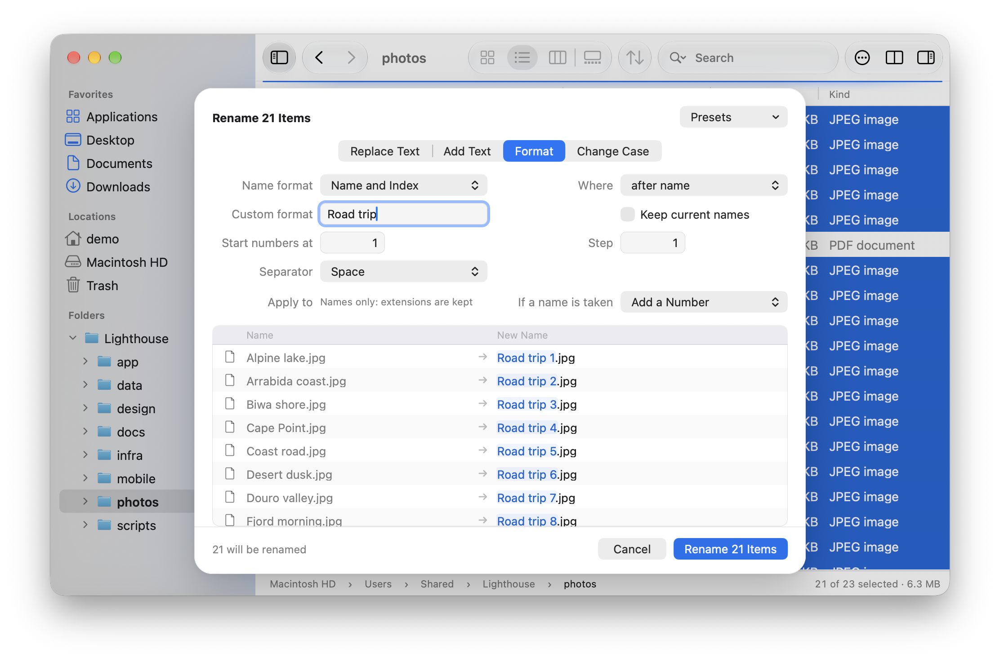
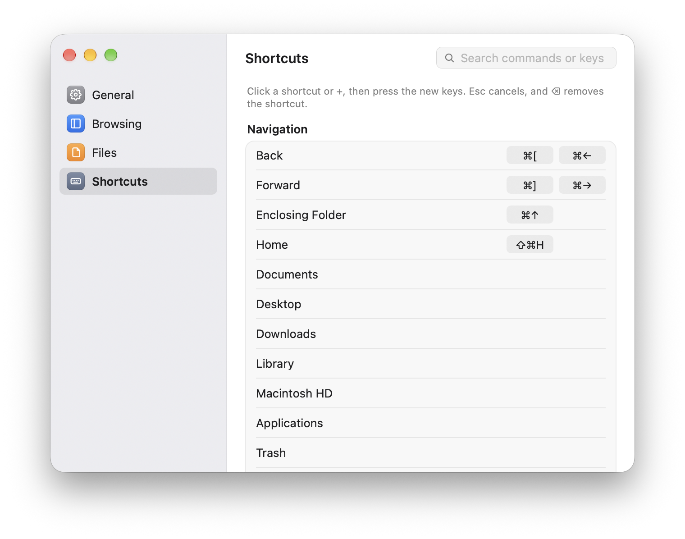
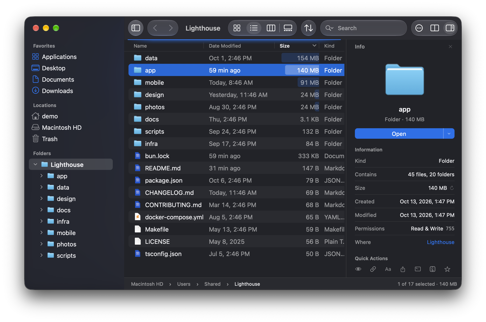

# Everything File Trail does

The [README](../README.md) is about what is different from Finder. This page lists the rest, by area, a line or two each. How to do each thing is in the app's own Help, which also lists every shortcut, the ones you changed included.

- [Getting around](#getting-around)
- [Tabs, panes, windows and workspaces](#tabs-panes-windows-and-workspaces)
- [Search and filtering](#search-and-filtering)
- [Copying, moving and undoing](#copying-moving-and-undoing)
- [Renaming](#renaming)
- [Archives and images](#archives-and-images)
- [Views](#views)
- [Sizes and information](#sizes-and-information)
- [Keyboard and commands](#keyboard-and-commands)
- [Looks and settings](#looks-and-settings)
- [With the rest of the Mac](#with-the-rest-of-the-mac)

## Getting around

- **A folder tree** beside the files: open a folder's arrow to look inside without leaving, or make one folder the top of the tree while you work inside it. ⇧⌘H goes back to Home.
- **Favorites** above the tree, with an icon of your choice for each, in the order you drag them to.
- **Locations**: Home, Macintosh HD, other disks and disk images with an Eject button, servers, and the Trash.
- **Go To (⌘K)** lists the folders you use most lately and your favorites, and finds one from a few letters. Start with `/` or `~` to type a path, and Tab completes it.
- **The path bar**: click a folder to jump to it, click a `›` to see the folders at that level, or double-click the bar to edit the path as text.
- **Back and Forward** remember more than one step: hold either button to pick from the folders it leads to.
- **The Go menu** has Home, Documents, Desktop, Downloads, Library, Macintosh HD, Applications and the Trash, like Finder's, each on a shortcut you choose.
- **The folder on screen stays current**: what other apps add, rename or remove there shows up as it happens.

## Tabs, panes, windows and workspaces

  

- **Tabs**, up to 25 in a window, each with its own folder, history, folder tree, view, sort order and search. ⇧⌘T reopens the tab closed last, as it was.
- **Two panes** in a tab (⌘\\), each with its own folder, history, view, filter and search. F5 copies what is selected to the other pane and F6 moves it; ⌥⌘↓ opens the selected folder there, and ⌘U swaps the panes.
- **Windows**, each with its own tabs. Move a tab into a window of its own, or merge every window back into one.
- **Workspaces**: save a window's tabs with their panes, views and sizes, the folder tree and the Info panel under a name. Window ▸ Workspaces opens it again in a new window, or with ⌥ in place of the one you are in, and the first five open with ⌃⌘1 to ⌃⌘5. Settings → Browsing renames, removes and reorders them.
- **Back as you left it**: your windows, tabs and panes come back when you open File Trail again, if you want them.

## Search and filtering

- **Search as you type**, of everything under the folder you are in, by name or full path, in plain text, glob or regex. One click widens it to Home or the whole disk.
- **Plain text** ignores case, and a plain letter finds its accented forms: `resume` finds Résumé.
- **Options**: hidden files, and inside a Git repository, leaving out `.git` and whatever `.gitignore` excludes.
- **Results in any view**, with columns of their own that you choose and sort, and a filter field that trims them by name or by folder without searching again. A search stops at 50,000 results.
- **Each tab keeps its own search**, a search keeps running while you look at another tab, and ⇧⌘F shows the last results again.
- **Results stay put while you work in them**: what you move away or delete leaves the list, what you rename keeps its place, and when you add something to the folder searched a note offers Search Again rather than searching on its own.
- **Type in the file list** to narrow the folder on screen. Fuzzy keeps the names with your letters in order, and marks them; Contains keeps the names with the letters side by side. Backspace edits what you typed, Esc brings the rest back, and ⌘F turns the same text into a search of the subfolders.
- **A pinned filter** stays while you go from folder to folder and search.

## Copying, moving and undoing

- **Cut, copy and paste** with ⌘X, ⌘C and ⌘V, between tabs and windows. Cut and copied items stay marked, and a toolbar button counts and lists them.
- **A paste asks before it overwrites**: Skip, Keep Both or Replace for each item, Merge for a folder, or one choice for all of them, with Add Missing for folders. Anything replaced goes to the Trash.
- **Careful with your files**: a move to another disk checks each copy before it removes the original, and a Replace that was cut short carries on the next time File Trail opens.
- **Move To** asks for a folder and finds it from a few letters; **Duplicate**, **New Folder** and **Move to Trash** work as in Finder.
- **Drag and drop** inside File Trail and with Finder and other apps, in both directions, by Finder's rules: Option copies, Command moves, and resting on a folder opens it.
- **Undo and Redo (⌘Z, ⇧⌘Z)** for renames, moves, copies, Move to Trash, New Folder, Compress, Extract and Convert Images, one step at a time. The toolbar can hold a button that lists what each would do.
- **Paste as File (⇧⌘V)** saves a screenshot or text you copied in another app as a new file in the folder you are in, and **Copy Contents (⇧⌘C)** copies a file's image or text to paste in another app.
- **File Trail's clipboard for files is its own**: files cut or copied here are pasted here, not in Finder or other apps. Between apps, drag them.

## Renaming

  

- **Rename one item** in place with F2, or with Return if you choose that in Settings.
- **Rename many at once**: replace or add text, number items or add their date, or change their case, with every new name shown before anything is renamed.
- **Find and replace can use regular expressions**, photos can be named by the date they were taken, and renames you repeat can be saved as presets.
- **When a new name is already taken**, you choose: add a number, skip those items, or rename nothing.

## Archives and images

- **Compress** makes a zip of the selected items next to them, as Finder's does.
- **Extract** takes zip, tar, 7z, RAR and xar archives apart next to themselves, and **Extract To** into a folder you choose. Opening an archive extracts it in File Trail and shows you what came out, with no other app opening.
- **An archive from the internet** keeps its quarantine on everything it gives.
- **Convert Images** makes copies of the selected images as JPEG, HEIC, PNG, TIFF or AVIF, at their size or smaller, with or without their metadata and location.
- Each of these can be stopped part way, and one Undo takes back what it made.

## Views

- **Icons** shows Quick Look previews of photos, PDFs and other documents, at the size you set.
- **List** has columns for date, size and kind, and optionally date created and permissions. Each column keeps the width you give it, in each pane apart.
- **Compact List** packs a folder into columns of names.
- **Previews (⌘4)** fills the pane with 9, 4, 2 or 1 large previews, each in its own proportions. View ▸ Show Previews switches to it at the count you pick from any view, search results too, with the selected file on screen.
- **Quick Look** on Space and ⌘Y, in every view.
- **Sorting** by name, kind, date or size, with folders kept first when you want them, and hidden files on a key (⇧⌘.).
- **Names sorted the way your language sorts them**, with numbers in order (`file2` before `file10`), and documents such as Keynote files shown as one item, not a folder.
- **Dates that read the way you would say them** ("24 min ago", "Yesterday, 6:03 PM").
- **Finder's tags** show as colored dots, and the right-click menu sets them.

## Sizes and information

- **Folder sizes**: ask for a folder's size and it is measured with every folder inside it, in one pass. Sorted by Size, each row of the List gets a bar. Sizes you ask for are measured one after another, ahead of those measured by themselves and never stopping each other; a size measured in one window shows in all of them.
- **Sizes only where you ask**: nothing is measured while you browse, so a large folder opens at once. With the Info panel or the Info Row open, the folder they show is measured by itself when it is in your home folder; Settings can turn that off.
- **Activity**: while something runs in the background, a ring at the end of the toolbar's title shows it, filling as a file operation goes on, with "+2" when more runs or waits; a click lists them, the file operation and the folder sizes being measured or waiting, each with Stop.
- **The Info panel** shows the selected item's kind, size, dates and permissions, with Open, Open With and quick actions. The **Info Row** shows the same along the bottom.

## Keyboard and commands

  

- **Select All, Deselect All (⌥⌘A) and Invert Selection** act on what the list shows: select the few to leave out, and Invert Selection selects the rest.
- **Everything from the keyboard**: Tab switches between the folder tree and the files, ⌘↑ goes up a folder and ⌘↓ opens what is selected, and Control-D and Control-U move half a page.
- **The command palette (⇧⌘P)** lists every command with where it is in the menus, its keys and a line on what it does. Type a few of its letters and press Return; the commands you ran last come first.
- **Your own shortcuts**: every command can have two, set in a list in Settings, with a warning before one is taken from another command. Only the keys every Mac app shares, like ⌘C, ⌘V, ⌘Z and ⌘Q, stay as they are.
- **Help** lists every shortcut as it is now, and finds one as you type.

## Looks and settings

  

- **Light and Dark**, following macOS or staying in the one you pick, with an accent color you choose.
- **The toolbar** is customized the way Finder's is: choose View ▸ Customize Toolbar, or right-click it, and drag buttons in, along or out.
- **Settings** cover the everyday choices: which app edits text files and which terminal opens, what Return does, whether disk images open in a new window or a new tab, which columns List view and search results show, and whether your tabs and last folder come back at launch.

## With the rest of the Mac

- **Open With** for the apps you choose, **Edit** in your text editor and **Open in Terminal** on a key, and **Copy Path**.
- **Share** the selected items by AirDrop, Mail, Messages and the rest, from the File menu, the right-click menu, the Info panel or the toolbar.
- **Disk images** open in File Trail instead of a Finder window, and disks eject from the sidebar.
- **Show in Finder** takes you to the same item there.
- **The icons macOS itself draws** for each file and folder.
