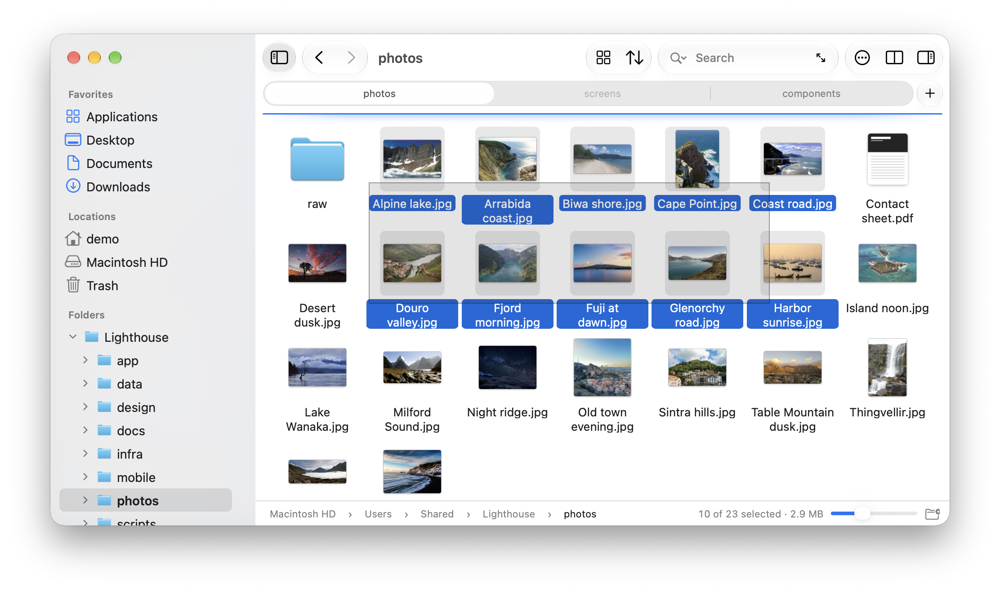
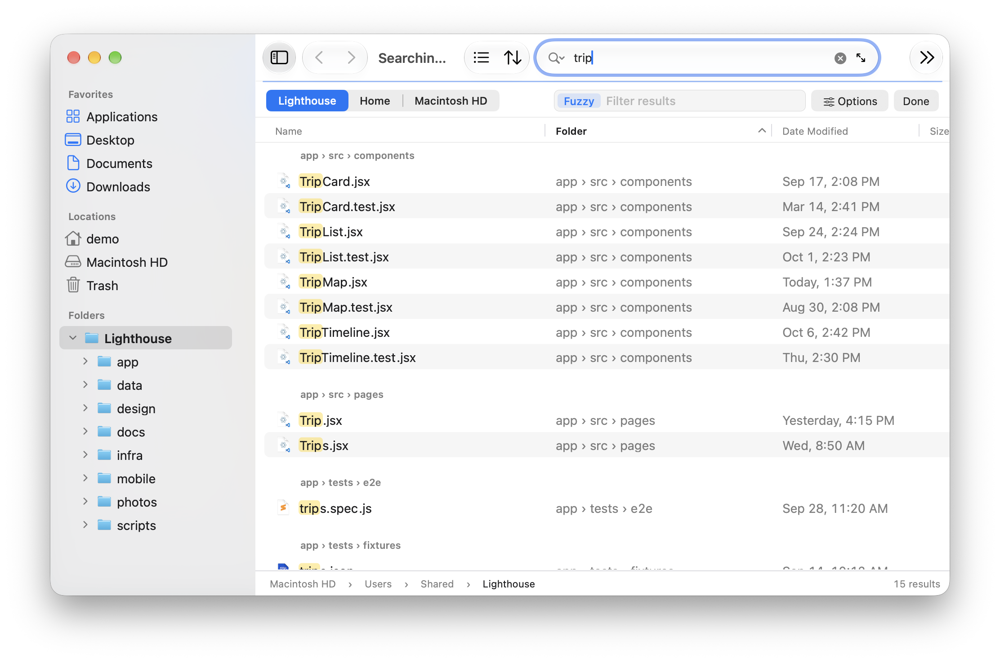
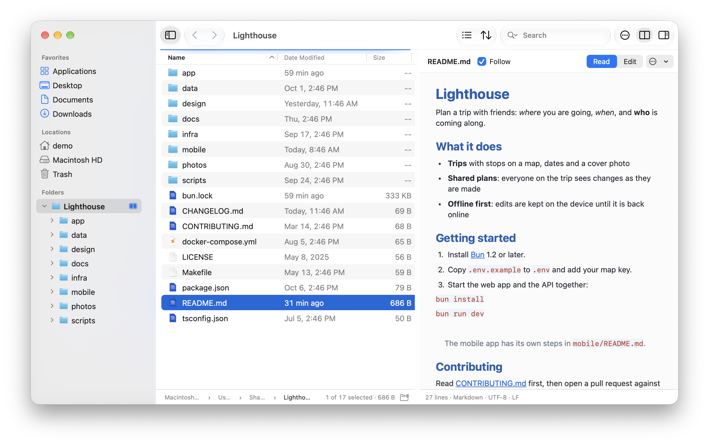

# Everything File Trail does

The [README](../README.md) is about what is different from Finder. This page lists the rest, by area, a line or two each. How to do each thing is in the app's own Help, which also lists every shortcut, the ones you changed included.

- [Getting around](#getting-around)
- [Tabs, panes, windows and saved views](#tabs-panes-windows-and-saved-views)
- [Search and filtering](#search-and-filtering)
- [Copying, moving and undoing](#copying-moving-and-undoing)
- [Renaming](#renaming)
- [Archives and images](#archives-and-images)
- [Views](#views)
- [Sizes and information](#sizes-and-information)
- [Keyboard and commands](#keyboard-and-commands)
- [Looks and settings](#looks-and-settings)
- [With the rest of the Mac](#with-the-rest-of-the-mac)

## Getting around

- **A folder tree** beside the files: open a folder's arrow to look inside without leaving, or make one folder the top of the tree while you work inside it. ⇧⌘H goes back to Home.
- **Favorites** above the tree, with an icon of your choice for each, in the order you drag them to.
- **Locations**: Home, Macintosh HD, other disks and disk images with an Eject button, servers, and the Trash.
- **Go To (⌘K)** lists the folders you use most lately and your favorites, and finds one from a few letters. Start with `/` or `~` to type a path, and Tab completes it.
- **The path bar**: click a folder to jump to it, click a `›` to see the folders at that level, or double-click the bar to edit the path as text.
- **Back and Forward** remember more than one step: hold either button to pick from the folders it leads to.
- **The Go menu** has Home, Documents, Desktop, Downloads, Library, Macintosh HD, Applications and the Trash, like Finder's, each on a shortcut you choose.
- **The folder on screen stays current**: what other apps add, rename or remove there shows up as it happens.

## Tabs, panes, windows and saved views

  

- **Tabs**, up to 25 in a window, each with its own folder, history, folder tree, view, sort order and search. ⇧⌘T reopens the tab closed last, as it was.
- **Two panes** in a tab (⌘\\), each with its own folder, history, view, filter and search. F5 copies what is selected to the other pane and F6 moves it; ⌥⌘↓ opens the selected folder there, and ⌘U swaps the panes. **Duplicate Pane** (⌥⌘\\, in the View menu, and a toolbar button you can add) opens a copy of the pane you are in beside it, with the same folder, view and history, in place of the other pane when two are open.
- **Between the panes**: Tab walks the folder tree, the left pane and the right pane; ⌥-click a folder in the tree to open it in the other pane; drag from one pane onto the other; and right-click for an Other Pane submenu, or with one pane, Open in Other Pane. Hidden files show in both panes of a tab or in neither.
- **A line along the top of the active pane** shows where the keyboard is: bright while the pane has it, dimmer while the sidebar or the search field does.
- **⌘W closes the pane you are in** when a tab has two, and the tab when it has one; ⌥⌘W closes the tab with both. ⌘\\ brings a closed pane back as it was.
- **Windows**, each with its own tabs. Move a tab into a window of its own, or merge every window back into one.
- **Tab views**: save what you choose of a tab under a name, two panes with the left in List and the right in Previews, say, with or without their folders, and give any tab that setup with one choice from Saved Views, or ⌥⌘1 to ⌥⌘5. What you don't choose stays as the tab has it. A tab view can also be what every new tab opens with.
- **Window views**: a window of tabs, each opened with a tab view, its size and panels if you like. Saved Views opens it in a new window, or with ⌥ in place of the one you are in, and the first five open with ⌃⌘1 to ⌃⌘5. The Views window lists folder views, tab views and window views, to reorder, rename, edit and remove.
- **Back as you left it**: your windows, tabs and panes come back when you open File Trail again, if you want them.

## Search and filtering

  

- **Search as you type**, of everything under the folder you are in, by name or full path, in plain text, glob or regex. One click widens it to Home or the whole disk.
- **Plain text** ignores case, and a plain letter finds its accented forms: `resume` finds Résumé.
- **Options**: hidden files, and inside a Git repository, leaving out `.git` and whatever `.gitignore` excludes.
- **Results grouped and sorted your way**: by the folder each result is in, by name or kind, or by a date, size or tag, which File Trail reads for the results in the background while they are grouped or sorted by it.
- **Results in any view**, with columns of their own that you choose and sort, and a filter field that trims them by name or by folder without searching again. A search stops at 50,000 results, and the status bar says so when some folders couldn't be read.
- **Each tab keeps its own search**, a search keeps running while you look at another tab, and ⇧⌘F shows the last results again.
- **Results stay put while you work in them**: what you move away or delete leaves the list, what you rename keeps its place, and when you add something to the folder searched a note offers Search Again rather than searching on its own.
- **Type in the file list** to narrow the folder on screen. Fuzzy keeps the names with your letters in order, and marks them; Contains keeps the names with the letters side by side. Backspace edits what you typed, Space types a space in it (⌘Y is Quick Look meanwhile), Esc brings the rest back, and ⌘F turns the same text into a search of the subfolders.
- **A pinned filter** stays while you go from folder to folder and search.

## Copying, moving and undoing

- **Cut, copy and paste** with ⌘X, ⌘C and ⌘V, between tabs and windows. Cut and copied items stay marked, and a toolbar button counts and lists them.
- **A paste asks before it overwrites**: Skip, Keep Both or Replace for each item, Merge for a folder, or one choice for all of them, with Add Missing for folders. Anything replaced goes to the Trash.
- **Careful with your files**: a move to another disk checks each copy before it removes the original, and a Replace that was cut short carries on the next time File Trail opens.
- **Move To** asks for a folder and finds it from a few letters; **Duplicate**, **New Folder**, **New Folder with Selection (⌃⌘N)** and **Move to Trash** work as in Finder.
- **A folder that isn't there yet**, typed in Move To or Extract To, is made on the way after a second Return, and undone apart from the move.
- **Drag and drop** inside File Trail and with Finder and other apps, in both directions, by Finder's rules: Option copies, Command moves, and resting on a folder opens it.
- **Replace Older** brings a backup up to date: when the same folders meet, only files newer than the ones there replace them. It is offered on APFS, HFS+, exFAT and SMB, not on FAT, whose dates can be an hour off.
- **Undo and Redo (⌘Z, ⇧⌘Z)** for renames, moves, copies, Move to Trash, New Folder, New Folder with Selection, Compress, Extract and Convert Images, one step at a time. The toolbar can hold a button that lists what each would do. Something that can't be undone (a merge, a move to another disk, Empty Trash) doesn't end the list: Undo says once that it can't be undone, and why, then goes on to what was done before it.
- **New File** makes an empty text file, or a copy of a file you keep in the Templates folder (right-click a file and choose Save as Template, or File ▸ New File ▸ Open Templates Folder): a letter, a Markdown note, a spreadsheet to start from. It opens for naming, as New Folder does.
- **Paste as File (⇧⌘V)** saves a screenshot or text you copied in another app as a new file in the folder you are in, and **Copy Contents (⇧⌘C)** copies a file's image or text to paste in another app.
- **Paste as File** keeps an image in the format it was copied in, and takes the text when a copy carries both. **Copy Contents** copies up to 10 MB of text or 100 MB of image, and asks before copying a file that usually holds a password or a key (`.env`, a private SSH key), marking it private for clipboard history apps.
- **File Trail's clipboard for files is its own**: files cut or copied here are pasted here, not in Finder or other apps. Between apps, drag them.
- **Gather from several folders**: Add to Copied Items (⌃⌘C) and Add to Cut Items (⌃⌘X) add to what is on the clipboard instead of replacing it. ⌘V copies the copied items and moves the cut ones in one paste and one Undo; Move Items Here (⌥⌘V) moves them all, as in Finder after Copy. The clipboard's list (⌃⌘V) shows what moves apart from what is copied, and switches an item with a click. Two items of one name are asked about as the second is added: keep both (the one added is pasted under a name of its own), use the new one, or leave it off. A clipboard built this way that a Copy or Cut replaces can be put back.
- **A paste that moves anything empties the clipboard** of what it pasted, copies too; only what failed or was skipped stays, to try again. A cut item you rename or move in File Trail stays on the clipboard; one you delete or move elsewhere comes off, and a note says so.

## Renaming

  

- **Rename one item** in place with F2, or with Return if you choose that in Settings.
- **Rename many at once**: replace or add text, number items or add their date, or change their case, with every new name shown before anything is renamed.
- **Find and replace can use regular expressions**, photos can be named by the date they were taken, and renames you repeat can be saved as presets.
- **When a new name is already taken**, you choose: add a number, skip those items, or rename nothing.

## Archives and images

- **Compress** makes a zip of the selected items next to them, as Finder's does.
- **Extract** takes zip, tar, 7z, RAR and xar archives apart next to themselves, and **Extract To** into a folder you choose. Opening an archive extracts it in File Trail and shows you what came out, with no other app opening. A zip whose names aren't UTF-8 (made on a Japanese, Chinese, Korean or Western European Windows) has them read in the encoding they fit.
- **What comes out**: an archive holding one item gives that item, and one holding several a folder named after the archive. A file compressed alone with gzip, bzip2 or xz is extracted too. Password-protected archives are not extracted yet: File Trail says so and names Archive Utility.
- **An archive from the internet** keeps its quarantine on everything it gives.
- **Convert Images** makes copies of the selected images as JPEG, HEIC, PNG, TIFF or AVIF, at their size or smaller, with or without their metadata and location.
- **Converted images** go beside their originals under the same name, numbered when it is taken, and the originals are never touched. The size is the image's own, a longest side to fit within, a percentage or a custom width and height; no image is ever made larger. A transparent image saved as JPEG gets a white background, and an animation gives its first frame.
- Each of these can be stopped part way, and one Undo takes back what it made.

## Views

- **Icons** shows Quick Look previews of photos, PDFs and other documents, at the size you set.
- **List** has columns for date, size and kind, and optionally date created, date added, date last opened and permissions. Right-click a column heading, or choose View ▸ Columns, to show or hide columns, and drag a heading to move its column. Each column keeps the width you give it, in each pane apart.
- **Folder views**: a folder can keep its own view, order, columns and size, for itself or for every folder inside it. Changes you make there show at once but are kept only with Save (View ▸ Folder View ▸ Update Folder View), and a small symbol in the status bar shows whether a folder has a view of its own and opens its options.
- **Folder Views** (View ▸ Folder View ▸ Manage Folder Views…) lists every folder with a view of its own, opens it, and removes its view, with or without those of the folders inside it.
- **Compact List** packs a folder into columns of names.
- **Sizes**: a slider in the status bar, and View ▸ Make Bigger, Make Smaller and Default Size (⌘+, ⌘- and ⌘0), set the icon size, the Compact List's column width and how many previews show. Each pane keeps its own.
- **Previews (⌘4)** fills the pane with 9, 4, 2 or 1 large previews, each in its own proportions. View ▸ Show Previews switches to it at the count you pick from any view, search results too, with the selected file on screen.
- **At 1 preview at a time** the file on screen is the selected one, so Space, the Info panel and Move to Trash act on what you see.
- **Quick Look** on Space and ⌘Y, in every view; while a filter is typed, on ⌘Y.

  

- **Open in Viewer (⌘E)** shows a file's text in place of the folder, with colors for about 60 languages and formats, to read or to edit and save, in Read or Edit as you last chose. It's a step of Back and Forward, so Back returns to the folder with the file selected, and the viewer's bar steps to the next and previous file.
- **Open in Other Pane (⌥⌘↓ or ⌥⌘E)** on a file shows it in the other pane, which then follows the list as you move through it: text with colors, Markdown as it reads, pictures and other files as Quick Look shows them. It keeps following while you edit, and asks to save before it moves on. A workspace keeps it, and the file it showed.
- **Markdown's pictures**: a picture beside the file, or anywhere on your Mac, shows in the Preview, shrunk to fit the pane, written in Markdown or as an HTML picture at the size and centering it gives. A picture on the web is never fetched, so a README can't tell anyone you read it; it shows as its description.
- **The viewer's own bar and menu**: Read or Edit, Save, Follow, and a ⋯ menu with Find, the language, light or dark whatever the app's appearance, one of three themes for each, the text size, wrapped lines and line numbers.
- **Groups**: put a folder's items in groups by name, a date (Today, Yesterday, Previous 7 Days and on), size, kind or tag, in every view, under a title for each, with the sort ordering the items inside each group, and the groups' own order reversed when you want the oldest or largest first. Search results group by any of these or by folder, and sort by a date or size too, and a folder can keep its grouping in its own view.
- **Sorting** by name, date modified, date created, date last opened, date added, size or kind, with folders kept first when you want them, and hidden files on a key (⇧⌘.).
- **Names sorted the way your language sorts them**, with numbers in order (`file2` before `file10`), and documents such as Keynote files shown as one item, not a folder.
- **Dates that read the way you would say them** ("24 min ago", "Yesterday, 6:03 PM").
- **Finder's tags** show as colored dots, and the right-click menu sets them.

## Sizes and information

- **Folder sizes**: ask for a folder's size and it is measured with every folder inside it, in one pass. Sorted by Size, each row of the List gets a bar. Sizes you ask for are measured one after another, ahead of those measured by themselves and never stopping each other; a size measured in one window shows in all of them.
- **A size is of what could be measured**: folders that change while they are measured are left out, and folders File Trail has no permission to read count as empty, as in Finder. Changes made outside File Trail leave a size as it was until you measure again, with Calculate Size or the refresh button beside it. A size waiting for another to finish says "Waiting…".
- **Sizes only where you ask**: nothing is measured while you browse, so a large folder opens at once. With the Info panel or the Info Row open, the folder they show is measured by itself when it is in your home folder; Settings can turn that off.
- **Activity**: while something runs in the background, a ring at the end of the toolbar's title shows it, filling as a file operation goes on, with "+2" when more runs or waits; a click lists them, the file operation and the folder sizes being measured or waiting, each with Stop.
- **The Activity list keeps its rows in place** while it is open: one that ended stays where it was, dimmed, saying how it ended, so Stop is never under the wrong row.
- **The Info panel** shows the selected item's preview, kind, size, dates and permissions, with Open, Open With and quick actions. The **Info Row** shows the same along the bottom.

## Keyboard and commands

  

- **Select All, Deselect All (⌥⌘A) and Invert Selection** act on what the list shows: select the few to leave out, and Invert Selection selects the rest.
- **Everything from the keyboard**: Tab switches between the folder tree and the files, ⌘↑ goes up a folder and ⌘↓ opens what is selected, and Control-D and Control-U move half a page.
- **The command palette (⇧⌘P)** lists every command with where it is in the menus, its keys and a line on what it does. Type a few of its letters and press Return; the commands you ran last come first.
- **Your own shortcuts**: every command can have two, set in a list in Settings, with a warning before one is taken from another command. Only the keys every Mac app shares, like ⌘C, ⌘V, ⌘Z and ⌘Q, stay as they are.
- **Help** lists every shortcut as it is now, and finds one as you type.

## Looks and settings

  

- **Light and Dark**, following macOS or staying in the one you pick, with the accent color of System Settings or one you choose.
- **The toolbar** is customized the way Finder's is: choose View ▸ Customize Toolbar, or right-click it, and drag buttons in, along or out.
- **A long name in a menu** loses its middle, as in Finder's menus, so the menu keeps its width.
- **Settings** cover the everyday choices: which app edits text files and which terminal opens, what Return does, whether disk images open in a new window or a new tab, and whether your tabs and last folder come back at launch.

## With the rest of the Mac

- **Open With** for the apps you choose, **Edit** in your text editor and **Open in Terminal** on a key, and **Copy Path**.
- **Share** the selected items by AirDrop, Mail, Messages and the rest, from the File menu, the right-click menu, the Info panel or the toolbar.
- **Disk images** open in File Trail instead of a Finder window, and disks eject from the sidebar.
- **Show in Finder** takes you to the same item there.
- **Finder aliases** open their originals, in File Trail for an alias of a folder, and look and sort as in Finder. File ▸ Make Alias (⌃⌘A) makes one beside the item, and Show Original selects the original in its folder. Symbolic links are called symbolic links.
- **The icons macOS itself draws** for each file and folder.
